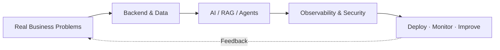

<div align="center">


# Hi, I'm LeonLiang 👋

### Software Engineer · Backend Development · AI Engineering

**从想法到产品，从代码到交付。**  
*Turning ideas into products, and prototypes into production-ready systems.*

[](https://github.com/YOUR_GITHUB_USERNAME)


[Projects](#-featured-projects) · [Tech Stack](#-tech-stack) · [About](#-about-me) · [Connect](#-connect)

</div>

---

## 👨‍💻 About Me

```yaml
name: LeonLiang
role: Software Engineering Student & Independent Developer
focus:
  - Java Backend & Full-Stack Engineering
  - AI Agents, RAG & LLM Applications
  - Intelligent Operations & Local LLM Deployment
principle: "Build what works. Ship what matters."
```

我是一名专注于 **Java 后端、全栈应用与 AI 工程化落地** 的软件开发者。

- 🔭 持续探索 **AI Agent × 传统 Web × 智能运维**，关注可观测、可控制、可交付的系统。
- 🧩 具备从需求分析、系统设计、数据库建模到前后端开发、部署运维的项目实践经验。
- 🏢 参与过企业订单管理、汽车租赁管理、在线考试、企业官网等真实业务系统的设计与实现。
- 🤖 实践过本地大模型部署、API 封装、RAG 知识库、Agent 工具调用与工作流编排。
- 🏆 已取得 **3 项软件著作权登记证书**，并参与学科竞赛及技术交流。
- 🎯 长期方向：**Backend Engineering / AI Application Engineering / AIOps**。

> 我相信 AI 应该成为可靠的软件能力，而不只是一个会聊天的演示窗口。

## 🧰 Tech Stack

<div align="center">


**Languages & Backend**


**Frontend & Data**


**AI & Infrastructure**


</div>

## 🚀 Featured Projects

| Project                                | What I Built                                                 | Key Technologies                                         |
| :------------------------------------- | :----------------------------------------------------------- | :------------------------------------------------------- |
| **LeonOpsAI · Intelligent Operations** | 面向 Java / Docker 服务的智能故障诊断方向：日志分析、RAG 知识检索、受控 Agent 工具调用、诊断过程追踪。 | `Spring Boot` `Agent` `RAG` `Loki` `PostgreSQL`          |
| **Enterprise Order Management**        | 企业订单管理平台：认证授权、角色权限、订单生命周期管理、后台数据维护与部署交付。 | `Java` `Spring Security` `MyBatis` `MySQL` `React / Vue` |
| **Vehicle Rental Management**          | 汽车租赁业务系统：车辆、司机、订单调度，时间冲突校验及历史订单管理。 | `Spring Boot` `MyBatis` `MySQL`                          |
| **LAN Examination System**             | 支持局域网运行的在线考试系统，探索离线部署与本地 AI 能力集成。 | `Java` `Spring Boot` `Web` `Local LLM`                   |
| **Enterprise Websites & Platforms**    | 企业官网、管理后台与业务数据系统，覆盖开发、发布和持续维护。 | `Nuxt` `Vue` `Nginx` `Docker`                            |

> 📌 项目涵盖已实践的系统与持续探索的方向。公开仓库后，可将上方项目名称替换为对应仓库链接，并补充截图、Demo 和架构说明。

## 🧠 Engineering Interests



我更关注 **AI 的工程边界**：权限隔离、工具调用约束、可追溯性、故障恢复、隐私保护以及人类确认机制。模型能力重要，系统可靠性同样重要。

## 📊 GitHub Activity

<div align="center">


</div>

<sub>统计卡片由第三方服务生成，可能受服务可用性或 GitHub API 限制影响；语言统计不等于个人技术熟练度。</sub>

## 🤝 Connect

- 💻 GitHub: [@YOUR_GITHUB_USERNAME](https://github.com/YOUR_GITHUB_USERNAME)
- 🌐 Website: [nemotion.cn](https://nemotion.cn)
- 📫 Email: `YOUR_EMAIL@example.com`

<div align="center">


**Build thoughtfully. Ship reliably. Keep learning.**

</div>
